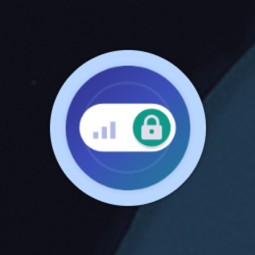
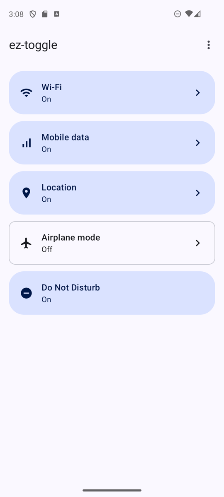
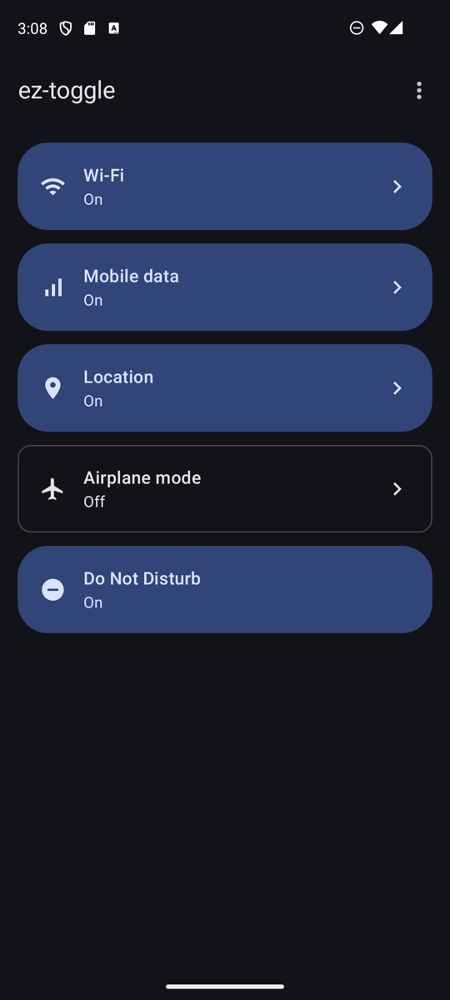
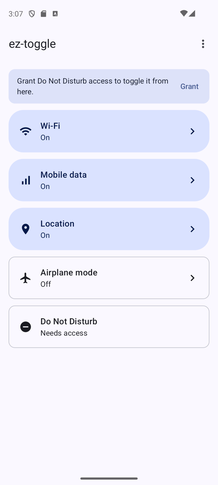
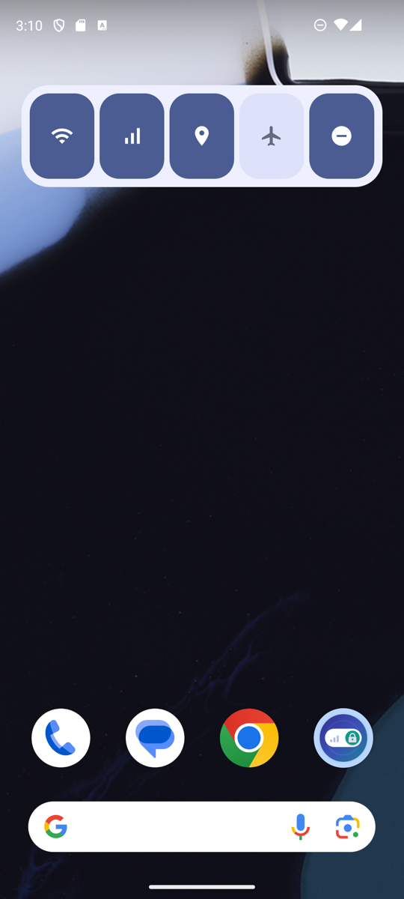
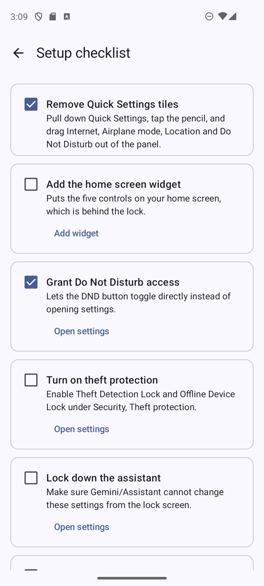

<p align="center">
  
</p>

<h1 align="center">ez-toggle</h1>

<p align="center">
  Wi-Fi, mobile data, location, airplane mode and Do Not Disturb controls that only work <b>after you unlock</b>.
</p>

---

## Why

On Pixel, a thief can pull down Quick Settings **from the lock screen** and kill Wi-Fi, mobile data, location or turn on airplane mode in seconds, which makes the phone hard to find with Find Hub.

The fix: remove those tiles from Quick Settings and use ez-toggle instead. Its controls live in an app and a home screen widget, both of which are behind the lock.

No root, no Shizuku, no ADB permissions, no internet permission. Nothing leaves the device.

## Screenshots

| Light | Dark | First launch |
|:---:|:---:|:---:|
|  |  |  |
| On = filled, extra-rounded card | Dynamic color, light/dark | Banner asks for DND access once |

| Home screen widget | Setup checklist |
|:---:|:---:|
|  |  |
| Tinted = on, muted = off | Ticks are saved |

<p align="center"></p>

## How each control works

Since Android 10, normal apps **cannot** silently toggle Wi-Fi, data, location or airplane mode. ez-toggle shows the live state and hands off to the system UI, so finishing the change takes one more tap.

| Control | Tap does | Extra taps |
|---|---|---|
| Wi-Fi | Opens the Wi-Fi panel (bottom sheet) | 1 |
| Mobile data | Opens the Internet panel | 1 |
| Location | Opens Location settings | 1 |
| Airplane mode | Opens Airplane mode settings | 1 |
| Do Not Disturb | **Toggles directly** (needs DND access once) | 0 |

Cards and widget buttons that open settings show a `›` arrow. DND doesn't, because it toggles in place.

## Lock safety

Every entry point (app tap, widget button, widget DND callback) goes through `KeyguardGuard`:

- **Unlocked:** run the action.
- **Locked, from the app:** ask the system to unlock first, and only continue if that succeeds.
- **Locked, from the widget DND button:** do nothing. A widget callback can't show the unlock prompt.

The home screen is already behind the lock; this is defense in depth.

## Setup

1. Build and install (see below).
2. Open the app, menu `⋮` → **Setup checklist**, and go through it:
   - Remove the Internet, Airplane mode, Location and DND tiles from Quick Settings.
   - Add the widget (button in the checklist).
   - Grant DND access.
   - Turn on Theft Detection Lock and Offline Device Lock.
   - Make sure Gemini/Assistant can't change these from the lock screen.
   - Re-check the tiles after every OS update; updates can bring them back.

## Build

Requires Android Studio (AGP 9.x). `minSdk 29`, `targetSdk 37`.

```bash
./gradlew assembleDebug             # build APK
./gradlew installDebug              # install on a connected device
./gradlew testDebugUnitTest         # JVM unit tests
./gradlew connectedDebugAndroidTest # Compose UI tests, needs a device/emulator
```

## Tech

- Kotlin, Jetpack Compose, Material 3 Expressive (dynamic color, spring motion, shape morph on toggle)
- Jetpack Glance widget with responsive sizes (icons only, icons + labels, 2 rows on narrow widths)
- MVI view model, manual DI, DataStore for checklist ticks
- No network, analytics, background services or polling

## Known limitations

- **Android 15+ Modes:** DND set by an app may show up as an app-owned mode, and turning it off may not clear a DND you started yourself.
- **Widget can go stale:** it refreshes after its own actions and when the app opens. Changes made elsewhere show up on the next refresh.
- **Location:** always opens Location settings; there's no "turn on" pop-up.

Screenshots were taken on a Pixel 8 emulator (Android 14).
